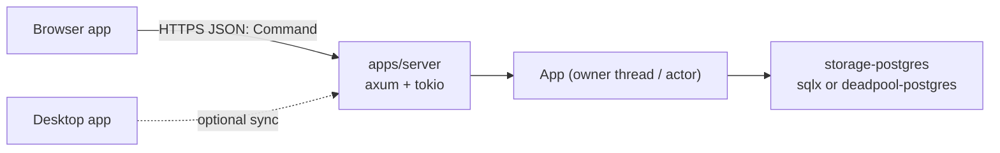
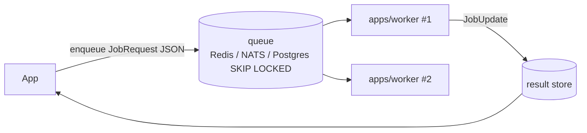
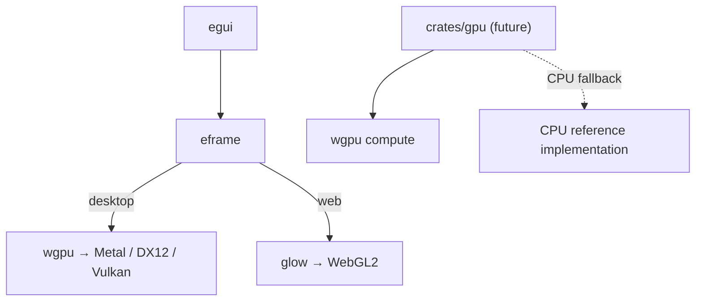

# Extension points

Documented integration concepts. None of these is implemented yet; each becomes an ADR when a project
needs it. Implement only what a concrete product requires.

## Server and PostgreSQL



- `apps/server` (L4): axum on tokio. It accepts `Command` JSON (same wire format as `rust-app exec`),
  authenticates the caller, checks `Effect` against the caller's permissions and forwards to `App`.
- `App` stays synchronous: the server owns it on a dedicated thread and sends commands through a
  channel (actor), or uses one `App` per request with a pooled repository via `spawn_blocking`.
- `crates/storage-postgres` (L2): implements `ItemRepository`; must pass `contract::run_all` against a
  test database (e.g. a container in CI). Connection pooling and migrations (`sqlx migrate`) live here.
- The browser **never** connects to PostgreSQL directly; a `storage-http` adapter in the browser would
  implement `ItemRepository` against the server API.

## Authentication and authorization

Not implemented, and not needed today: desktop and CLI run as the logged-in OS user on a local file
(protected by file permissions), the browser app keeps data per origin in the visitor's browser
([ADR 0015](../adr/0015-authentication-at-network-hosts.md)).

Authentication becomes necessary as soon as `App` is reachable over a network – a server, a sync
service, MCP over HTTP. Then:

```text
 client ──credentials/token──▶ host (apps/server, MCP-HTTP)        ◀── authentication (who?)
                                 │ verifies token, builds Caller
                                 ▼
                          App::execute_as(&Caller, Command)          ◀── authorization (may they?)
                                 │ checks Effect (read/write/destructive) against Caller roles
                                 ▼
                          domain rules · repository (owner_id per entity when data is per user)
```

- **Where:** authentication lives in the host (L4), e.g. axum middleware; the core never sees
  passwords or tokens. Authorization uses the existing `Effect` of each command plus a `Caller`
  (id, roles) passed into `App`. Per-user data adds an owner to the domain model and to every
  repository query.
- **Identity provider:** OpenID Connect (Keycloak, Entra ID, Auth0, …) instead of own password storage.
  The server validates JWTs (issuer, audience, expiry, signature via JWKS).
- **Browser app:** Authorization Code + PKCE; prefer a backend-for-frontend with an HttpOnly, Secure,
  SameSite session cookie over tokens in JavaScript. Never put secrets into the wasm bundle.
- **Desktop app:** Authorization Code + PKCE via the system browser and a loopback redirect
  (RFC 8252); refresh token in the OS keychain (`keyring` crate), never in the SQLite file.
- **CLI:** device authorization flow (RFC 8628) or a personal API token from an environment variable or
  the keychain.
- **Agents / MCP over the network:** bearer token, loopback binding by default, destructive commands
  still need explicit confirmation.

## External workers and distributed jobs (Celery-like)



- `JobRequest` and `JobState` are already serialisable – they are the wire format.
- A `QueueJobRunner` implements `JobRunner`: `submit` enqueues, `poll` reads updates.
- `apps/worker` (L4) runs the same `JobTask` implementations, built from the request; it needs read
  access to the inputs (snapshot in the message or repository access).
- Needed then: persistent job table, idempotency keys, retries with backoff, timeouts (visibility
  timeout), dead-letter queue, graceful shutdown (finish current step, requeue the rest).
- Docker: one image per binary (`desktop` excluded), `docker compose` with server, worker, Postgres, Redis.
  The browser app already has an image (`apps/web/Dockerfile`).

## MCP and agent control

- `crates/mcp` (L3, sibling of the UI) + `rust-app mcp` subcommand, stdio transport via `rmcp`
  (Apache-2.0, needs tokio – acceptable in this native host only).
- One tool per `Command` variant; input schema from `schemars` (`Command::json_schema()`), annotations
  from `Effect` (`readOnlyHint`, `destructiveHint`). Destructive tools require `confirm: true` or an
  allow-list configured by the user.
- Headless execution already exists (CLI, `App` without UI). UI automation and screenshots: drive the
  egui `Shell` with `egui_kittest` (with the `wgpu`/`snapshot` features for images).
- Network transports (HTTP/SSE) bind to loopback by default and require a bearer token.
- Until then, `rust-app exec --json` is a complete agent interface.

## GPU



- UI rendering (eframe) and compute are separate concerns.
- A `crates/gpu` (L2) would own compute pipelines (WGSL), share eframe's `wgpu::Device` via
  `eframe::Frame::wgpu_render_state()` or create its own, and always keep a
  CPU reference implementation for correctness tests and fallback.
- Custom rendering inside egui: `egui_wgpu::Callback` paint callbacks.
- Browser: switch eframe to wgpu with WebGPU (and WebGL fallback) when compute is needed in the browser.

## Other extensions

- **Undo/redo, audit log, macros:** see [commands.md](commands.md#events).
- **Configuration file:** a `Config` struct (serde, TOML) loaded by the host; today configuration is
  `--data-dir`/`RUST_APP_DATA_DIR` and `RUST_LOG`.
- **Packaging:** `cargo-dist` or `cargo-packager` for installers; code signing per platform.
- **Shell completion:** `clap_complete` subcommand.
