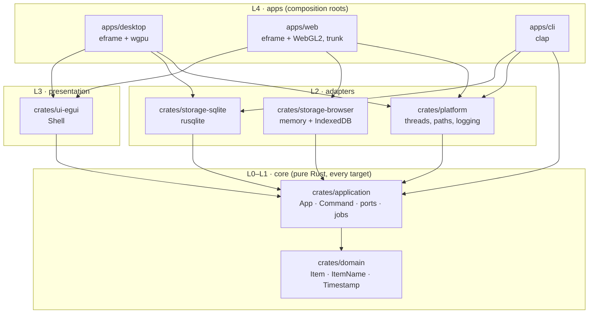
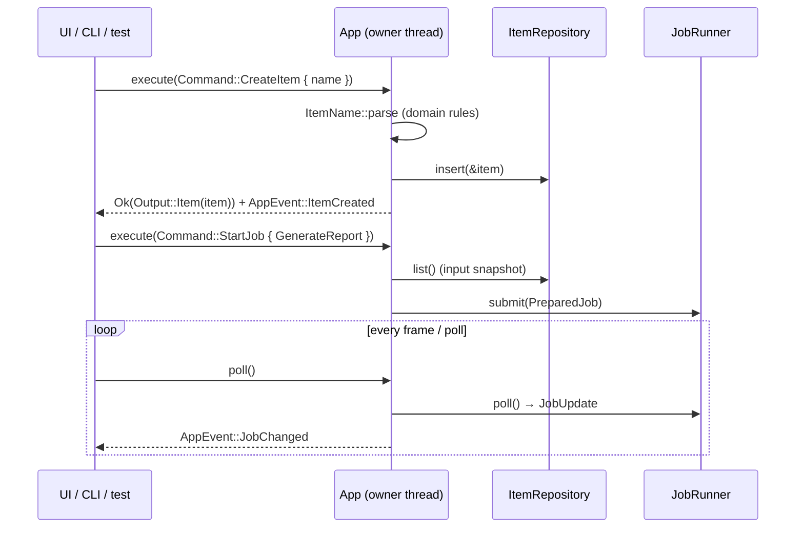

# Architecture overview

The starter kit is a small, complete application – an *item manager* – that runs as a **desktop app**,
a **browser app** and a **CLI**. All three execute the same typed commands against the same core.
The example domain is deliberately trivial; the structure around it is the product.

## Building blocks

| Crate | Responsibility | Targets |
|---|---|---|
| `domain` | Entities, value objects, domain errors. No I/O. | all |
| `application` | `App` service, `Command`/`Output`, events, ports (`ItemRepository`, `Clock`, `JobRunner`), job model, in-memory repository, repository contract tests | all |
| `platform` | Native: `ThreadJobRunner`, data directory, `env_logger`. Web: console logger, persistent-storage request | native / wasm modules |
| `storage-sqlite` | `ItemRepository` on SQLite with migrations | native |
| `storage-browser` | `ItemRepository` on memory + IndexedDB snapshot | wasm (logic tested natively) |
| `ui-egui` | `Shell`: navigation, item list and form, jobs view, about, status bar, theme switch | all |
| `apps/*` | Wire adapters into `App`; nothing else | per app |
| `xtask` | Build, lint, layer check, CI gate | native |

## Request flow

## Key principles (each backed by an ADR)

1. **Synchronous core, single owner** – no async runtime in the core; long work runs as jobs ([ADR 0001](../adr/0001-synchronous-single-owner-core.md)).
2. **Typed commands** – one serialisable `Command` enum for every frontend, JSON Schema for tools ([ADR 0002](../adr/0002-typed-command-enum.md)).
3. **Enforced layering** – `cargo xtask layers` ([ADR 0003](../adr/0003-layered-workspace-enforced-by-xtask.md), [dependency rules](dependency-rules.md)).
4. **Ports with real implementations only** – every trait has at least two implementations (repository: SQLite, browser, memory; job runner: threads, inline; clock: system, manual).
5. **Platform code at the edges** – `cfg(target_arch = "wasm32")` lives in adapters and hosts, never in the core ([platform abstraction](platform-abstraction.md)).
6. **Never crash** – `unwrap`, `expect`, `panic!`, `todo!`, `unimplemented!`, `unreachable!` are denied in non-test code of every crate; `unsafe` is forbidden workspace-wide.

## Further reading

- [Dependency rules](dependency-rules.md) · [Commands](commands.md) · [Platform abstraction](platform-abstraction.md) · [Extensions](extensions.md)
- [Target architecture (design record of Phase 2)](target-architecture.md)
