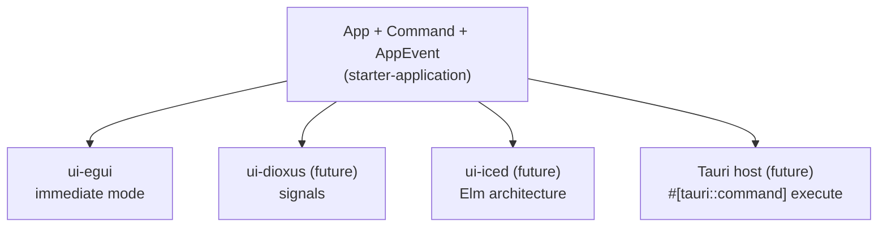

# Platform abstraction

Desktop, browser and CLI differ in threads, storage, time, windowing and file access. The kit isolates
these differences at the edges instead of abstracting the whole platform.

## Where platform differences live

| Concern | Native | Browser | Where |
|---|---|---|---|
| Persistence | SQLite file | memory + IndexedDB snapshot | `storage-sqlite`, `storage-browser` |
| Background jobs | `ThreadJobRunner` (OS threads) | `InlineJobRunner` (slices per frame) | `platform::native`, `application::jobs` |
| Wall clock | `SystemClock` (`web-time`) | same | `application::ports` |
| Logging | `env_logger` to stderr | browser console | `platform::{native, web}` |
| Data location | OS data dir (`directories`) | origin storage, `navigator.storage.persist()` | `platform` |
| Window / canvas | eframe native (wgpu) | eframe `WebRunner` (WebGL2) | `apps/desktop`, `apps/web` |
| Entry point | `fn main` | `spawn_local` from `main` on wasm32 | `apps/*` |

Rules:
- The core (`domain`, `application`) contains **no** `cfg(target_arch)` and no platform crate.
- Use `web-time` instead of `std::time::{Instant, SystemTime}` in code that runs in the browser;
  `std::time::Instant::now()` panics on `wasm32-unknown-unknown`.
- Never call `std::thread::spawn` or `std::thread::sleep` in shared code; use the `JobRunner` port.
- IDs: `uuid` needs its `js` feature on wasm32 (set in `crates/domain/Cargo.toml`).

## Swapping the UI framework

There is deliberately **no** widget abstraction. Frameworks differ too much (immediate mode, retained
mode, signals, WebView). Swappability is achieved at the `App` boundary:

How to add another frontend:

1. Create `crates/ui-<framework>` at layer 3 (register it in `xtask/src/layers.rs`); depend on
   `starter-application` only.
2. Own an `App` (or receive `&mut App` from the host). Translate user actions into `Command`s, render
   from `Output`s, refresh on `drain_events()`, call `poll()` regularly (timer or frame callback).
3. Create the host in `apps/<name>` and wire the same adapters as `apps/desktop`.

Framework notes:
- **Iced / Slint:** `App` lives in the application state; map `Command` results into messages.
  Use a subscription/timer to call `App::poll` while jobs run.
- **Dioxus:** keep `App` in a context provider (`Rc<RefCell<App>>` – single-threaded is fine); update
  signals from events.
- **Tauri:** the Rust side owns `App` behind a `Mutex` in Tauri state (Tauri commands may run on
  different threads; the mutex serialises them like the single-owner rule requires) and exposes
  `#[tauri::command] fn execute(cmd: Command) -> Result<Output, String>`. The web frontend sends the
  documented JSON. Events go to the frontend via `emit`.

## Browser limitations (summary)

- No threads without `SharedArrayBuffer` + cross-origin isolation; the kit runs jobs inline.
  CPU-heavy browser work belongs in a Web Worker (a second wasm instance, messages as JSON).
- No file system; files come from `<input type=file>`/drag-and-drop and leave as downloads.
- No TCP sockets; network only via `fetch`/WebSocket. No direct database connections.
- Storage can be evicted unless persistence is granted.
- Details: [docs/development/webassembly.md](../development/webassembly.md).
