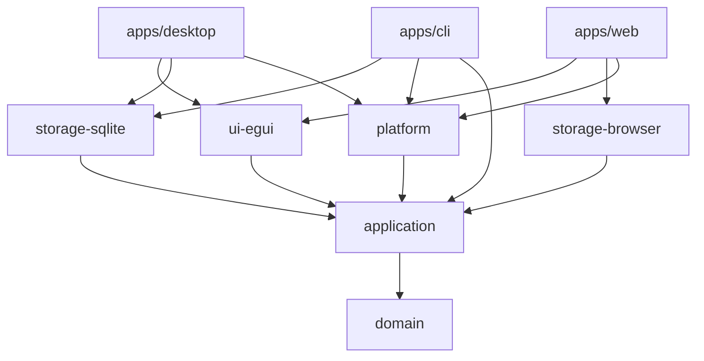

# Target Architecture – Rust Application Starter Kit

> **Status:** Design record of Phase 2 (2026-10-11). The implemented architecture is described in
> [overview.md](overview.md) and the [ADRs](../adr/README.md). Deviations during implementation:
> - Logging uses the `log` facade instead of `tracing` ([ADR 0012](../adr/0012-log-facade.md)).
> - IndexedDB is accessed through raw `web-sys` instead of `rexie`/`indexed_db_futures` (fewer, better maintained dependencies).
> - `SystemClock` and `InlineJobRunner` live in `starter-application` (they are platform-neutral via `web-time`);
>   `starter-platform` holds the native thread runner, data paths, logging and browser helpers.
> - `Command` gained `Info` and `ListJobs`; `cargo-deny` allows MPL-2.0 for `option-ext` only ([ADR 0010](../adr/0010-dependency-license-policy.md)).
> Library versions checked on crates.io on 2026-10-11.

---

## 1. Goals and non-goals

**Goals**
- One small, working reference application (an *item manager*) that runs as **desktop (egui)**,
  **browser (WASM)** and **CLI**, all executing the same application commands.
- A core that has no dependency on any UI framework, database driver or OS API.
- Dependency rules that are **checked by tooling**, not only documented.
- Clear, documented extension points for PostgreSQL, external workers, MCP, GPU and other UIs.

**Non-goals for the first version**
- No distributed job system, no server, no PostgreSQL implementation, no MCP implementation,
  no GPU demo, no plugin system, no release packaging for every platform.
  These are documented integration concepts until a real project needs them.

## 2. Key decisions

**Accepted by Mehmet on 2026-10-11** (ADRs are written together with the implementation in `docs/adr/`):

- **D1** – synchronous core with a single owner; tokio only in future network hosts.
- **D4** – browser persistence: in-memory repository + snapshot flushed to IndexedDB.
- **License** – `MIT OR Apache-2.0`.
- **Skill location** – versioned in this repository under `.agents/skills/rust/`
  (deliberate exception to the "AI helper files are not committed" default; to be recorded in the
  project `CLAUDE.md`).

All other rows below are still **Proposed**.

| # | Topic | Proposal | Alternative considered |
|---|---|---|---|
| D1 | Core execution model | **Synchronous core, single owner** (`&mut App`), long work as detached jobs | Async core on tokio (see §5.3) |
| D2 | Command model | **Typed serde enum** + metadata table + JSON Schema via `schemars` | String ids with untyped `Value` params |
| D3 | Native persistence | **SQLite via `rusqlite`** (bundled), migrations via `PRAGMA user_version` | SQLx (async-only, no wasm) |
| D4 | Browser persistence | **In-memory repository + snapshot flushed to IndexedDB** | SQLite in the browser (`rusqlite` + `sqlite-wasm-rs`), localStorage |
| D5 | Background jobs | Own small `JobRunner` port: threads natively, inline on web | tokio tasks, `apalis`-style queues |
| D6 | UI framework | egui/eframe 0.36; desktop renderer **wgpu**, web renderer **glow (WebGL2)** | wgpu/WebGPU on web |
| D7 | Web build | **trunk** | wasm-bindgen CLI driven by xtask |
| D8 | CLI | **clap** (derive), `--json` output, defined exit codes | hand-rolled parsing |
| D9 | Layer enforcement | `cargo xtask layers` reading `cargo metadata` | none / cargo-deny bans only |
| D10 | Quality gates | `rust-toolchain.toml`, fmt, clippy `-D warnings`, never-crash lints, tests, wasm build, `cargo-deny` | – |

## 3. Workspace layout (first version)

Six library crates, three apps, xtask. Every crate exists because it has a real implementation.

```text
rust-app-starter/
├── Cargo.toml                 workspace, shared deps, lints, profiles
├── rust-toolchain.toml        pinned toolchain + wasm32 target
├── deny.toml                  cargo-deny: licenses, advisories, bans
├── .cargo/config.toml         alias xtask
├── crates/
│   ├── domain/                entities, value objects, domain errors – pure Rust
│   ├── application/           App service, Command enum + metadata, events, ports (traits), jobs model,
│   │                          in-memory repository (tests + browser base)
│   ├── platform/              native: thread job runner, system clock, data dirs
│   │                          web: inline job runner, browser clock   (cfg-gated modules)
│   ├── storage-sqlite/        ItemRepository on SQLite (native only)
│   ├── storage-browser/       ItemRepository on memory + IndexedDB snapshot (wasm only)
│   └── ui-egui/               egui shell: sidebar, list, form, status bar, theme, job progress
├── apps/
│   ├── desktop/               eframe native host, wires SQLite + thread jobs + ui-egui
│   ├── web/                   eframe web host (trunk), wires browser storage + inline jobs + ui-egui
│   └── cli/                   clap host, wires SQLite + application (no UI crates)
├── xtask/                     desktop | web | cli | test | lint | layers | wasm | ci
├── docs/
│   ├── adr/                   Architecture Decision Records (Nygard format)
│   ├── architecture/          overview, dependency rules, commands, platform abstraction
│   └── development/           getting started, desktop, web, cli, database, background jobs
├── .agents/skills/rust/       (Phase 6, see open question Q4)
└── .github/workflows/ci.yml
```

**Deferred (only when needed):** `apps/worker`, `apps/server`, `crates/storage-postgres`,
`crates/mcp`, `crates/gpu`, `crates/ui-<other>`.

## 4. Dependency rules



| Layer | Crates | May depend on | Must not depend on |
|---|---|---|---|
| L0 | `domain` | std, serde, thiserror, uuid | everything else |
| L1 | `application` | L0, schemars | UI, DB drivers, web-sys, threads |
| L2 | `platform`, `storage-sqlite`, `storage-browser` | L0–L1, their own driver | UI crates, each other |
| L3 | `ui-egui` | L0–L1, egui | storage crates, platform, eframe-native APIs |
| L4 | `apps/*` | anything below | – |

Rules are checked by `cargo xtask layers` (CI). UI-framework crates (`egui`, `eframe`, `winit`,
`dioxus`, `tauri`, `iced`, `slint`) are banned below L3; DB drivers are banned in L0–L1.

## 5. Application core

### 5.1 Domain

```rust
pub struct ItemId(Uuid);                    // newtype, serde transparent
pub struct ItemName(String);                // validated: trimmed, 1..=120 chars
pub struct Item { pub id: ItemId, pub name: ItemName, pub created_at: Timestamp, pub updated_at: Timestamp }

#[derive(thiserror::Error)]
pub enum DomainError { EmptyName, NameTooLong { max: usize } }
```

### 5.2 Commands, queries and events

One serialisable enum is the contract for **every** frontend (GUI, CLI, MCP, tests, future REST):

```rust
#[derive(Serialize, Deserialize, JsonSchema)]
#[serde(tag = "command", content = "params", rename_all = "snake_case")]
pub enum Command {
    CreateItem { name: String },
    RenameItem { id: ItemId, name: String },
    DeleteItem { id: ItemId },
    ListItems,
    GetItem { id: ItemId },
    StartJob { job: JobRequest },
    CancelJob { id: JobId },
}

pub enum Effect { Read, Write, Destructive }      // drives MCP annotations and confirmation

pub struct CommandMeta { pub name: &'static str, pub label: &'static str, pub effect: Effect }

impl Command { pub fn meta(&self) -> CommandMeta { /* exhaustive match */ } }

pub enum Output { Item(Item), Items(Vec<Item>), Deleted(ItemId), Job(JobId), None }

pub enum AppEvent { ItemCreated(ItemId), ItemUpdated(ItemId), ItemDeleted(ItemId),
                    JobProgress { id: JobId, done: u32, total: u32 }, JobFinished { id: JobId, result: JobResult } }
```

- **Typed instead of untyped `Value` params:** invalid params fail at deserialisation, and
  `schemars` generates a JSON Schema for the whole enum – usable for MCP tool discovery and CLI `--help`.
- **Exhaustive `meta()`:** adding a command without metadata does not compile.
- **Undo/redo, audit log, macros** are extension points: because every mutation is a `Command`,
  an audit log is "append the command + result"; undo follows an inverse-command pattern
  when a project needs it. Not implemented in the first version.

### 5.3 The App service and the execution model (D1)

```rust
pub struct App { repo: Box<dyn ItemRepository>, jobs: Box<dyn JobRunner>, clock: Box<dyn Clock>, events: Vec<AppEvent> }

impl App {
    pub fn new(repo: Box<dyn ItemRepository>, jobs: Box<dyn JobRunner>, clock: Box<dyn Clock>) -> Self;
    pub fn execute(&mut self, cmd: Command) -> Result<Output, AppError>;   // THE entry point
    pub fn poll(&mut self);                                                 // applies finished job results
    pub fn drain_events(&mut self) -> Vec<AppEvent>;                        // UIs pull changes
}
```

**Proposal: synchronous core with a single owner:**
- `App` is owned by one thread (UI thread in desktop/web, main thread in CLI). No `Arc<Mutex<_>>`.
- Short operations (SQLite insert, IndexedDB-backed memory write) run directly in `execute`.
- Long or CPU-heavy work is a **job**: data goes out as a `Send` value, the result comes back through
  `poll()` and is committed on the owner thread.
- Works identically on wasm (no `Send` futures, no runtime), keeps egui integration trivial and
  keeps tests plain `#[test]` functions.

**Alternative: async core on tokio** (`async fn execute`, async repository traits, SQLx).
- Pro: natural for servers, network I/O and PostgreSQL; SQLx gives one query layer for SQLite + Postgres.
- Contra: async traits are not dyn-compatible without boxing (`async-trait`); futures must be `Send`
  natively but are `!Send` on wasm, which forces dual trait definitions; SQLx does not support wasm;
  egui needs a runtime on a side thread plus channels; tests need a runtime.
- **Recommendation:** sync core now; tokio lives only in hosts that need it (future server, MCP over
  HTTP, network adapters). A server wraps `App` behind a dedicated owner thread (actor) or
  `spawn_blocking`. This keeps the decision reversible at the host level.

### 5.4 Ports

```rust
pub trait ItemRepository {
    fn insert(&mut self, item: &Item) -> Result<(), StorageError>;
    fn update(&mut self, item: &Item) -> Result<(), StorageError>;
    fn delete(&mut self, id: ItemId) -> Result<bool, StorageError>;
    fn get(&self, id: ItemId) -> Result<Option<Item>, StorageError>;
    fn list(&self) -> Result<Vec<Item>, StorageError>;
}

pub trait Clock { fn now(&self) -> Timestamp; }

pub trait JobRunner {
    fn submit(&mut self, id: JobId, job: JobRequest, cancel: CancelToken);
    fn poll(&mut self) -> Vec<JobUpdate>;   // progress + finished results, drained by App::poll
}
```

Only ports with at least two real implementations exist (repository: SQLite, browser, memory;
job runner: threads, inline; clock: system, fixed for tests).

## 6. Persistence (D3, D4)

| Platform | Adapter | Notes |
|---|---|---|
| Desktop, CLI | `storage-sqlite` (`rusqlite` 0.40, `bundled`) | one file in the OS data dir (`directories`), WAL mode, migrations via `PRAGMA user_version` + embedded SQL files, transactions per command |
| Browser | `storage-browser` | `InMemoryItemRepository` + snapshot (JSON) flushed asynchronously to IndexedDB after each write; loaded once at start-up before the UI starts |
| Tests | `InMemoryItemRepository` (in `application`) | also used by the browser adapter |
| Server (later) | `storage-postgres` | only behind a server/API; the browser never talks to PostgreSQL |

- Connection pooling is not needed for a single-user desktop SQLite file; it becomes relevant with the
  server/Postgres extension (then: SQLx or `deadpool-postgres`, decided in an ADR at that time).
- **Browser alternative (Q2):** `rusqlite` supports `wasm32-unknown-unknown` through `sqlite-wasm-rs`
  (default feature). That would give *one SQL code path* for desktop and web. Costs: SQLite C sources
  must be compiled with a wasm-capable clang (Apple's clang is not; Homebrew LLVM needed), persistent
  OPFS storage (`sahpool` VFS) only works inside a dedicated Web Worker, and the memory VFS would still
  need our own snapshot flush. Recommended only after a spike.

## 7. Background jobs (D5)

Five concepts, kept separate:

| Concept | Tool | Where |
|---|---|---|
| Async I/O | tokio | only in future network hosts (server, MCP/HTTP); not in the core |
| CPU parallelism | rayon | inside a job's work function (native only) |
| OS threads | `std::thread` | `platform::native::ThreadJobRunner` (small fixed pool) |
| Background jobs | `JobRunner` port + `JobRequest` enum | application (model) + platform (runners) |
| Distributed workers | Redis/NATS/Postgres queue + `apps/worker` | documented concept only |

- Job model: `JobId`, `JobRequest` (serde enum), `JobState { Queued, Running { done, total }, Done, Failed, Cancelled }`,
  `CancelToken` (`Arc<AtomicBool>`), progress via atomics/channel.
- Work functions are pure (`fn run(req, &JobContext) -> Result<JobOutput, JobError>`); results are
  applied to the repository only in `App::poll()` on the owner thread.
- Web: `InlineJobRunner` runs a bounded slice of work per frame (or the whole job when small).
  Web Workers are a later extension (second wasm instance, JSON wire format).
- Demo job: `GenerateReport` – iterates all items with progress and cancellation, shown in the UI.
- Persistence, retries, timeouts, idempotency keys and graceful shutdown are fields/extension points
  in the model; the distributed version (Celery-like) is documented in `docs/development/background-jobs.md`.

## 8. UI (D6) and swappability

- `ui-egui` exposes `pub struct Shell` with `fn ui(&mut self, ctx: &egui::Context, app: &mut App, host: &dyn HostServices)`.
  It only calls `app.execute(..)`, reads `Output`s and events – **never** a repository.
- Layout: sidebar navigation (Items, Jobs, About), list, create/rename form, status bar, light/dark toggle,
  job progress (asynchronous update via `App::poll()` + `ctx.request_repaint_after`).
- `HostServices` trait (injected by the host): open URL, platform name, data location – no file dialogs
  in the first version.
- **Swappability is achieved at the `App`/`Command` boundary, not with a widget abstraction.**
  A Tauri host exposes one `#[tauri::command] fn execute(cmd: Command)`; a Dioxus/Iced/Slint host owns
  `App` and maps events to its own state. Documented in `docs/architecture/platform-abstraction.md`.
- egui UI tests with `egui_kittest` (headless, no window).

## 9. Hosts

| Host | Wiring | Notes |
|---|---|---|
| `apps/desktop` | eframe (wgpu) + `SqliteItemRepository` + `ThreadJobRunner` + `SystemClock` | Windows/Linux/macOS; CI builds all three |
| `apps/web` | eframe `WebRunner` (glow) + `BrowserItemRepository` + `InlineJobRunner` | trunk; `index.html` + canvas; single-threaded |
| `apps/cli` | clap + `SqliteItemRepository` + `ThreadJobRunner` | `create`, `list`, `rename`, `delete`, `info`, `commands --schema`, `exec <json>`; `--json`; exit codes 0/1/2 (ok / domain error / usage) |

`cli exec '{"command":"create_item","params":{"name":"X"}}'` executes any command from JSON –
the bridge for scripts and agents until MCP exists.

## 10. Agent readiness (Phase 5 concept)

- `Command` JSON Schema (schemars) → MCP tools generated per variant with real input schemas
  (instead of free-form tools with untyped params).
- `Effect` → MCP `readOnlyHint` / `destructiveHint`; destructive commands require an explicit
  confirmation flag or an allow-list configured by the user.
- MCP transport: stdio first, via `rmcp` (Apache-2.0, needs tokio – acceptable in the native MCP host only).
- Headless execution is already given (CLI, `App` without UI); UI screenshots via `egui_kittest`.
- Auth: local stdio needs none; any network transport (HTTP/TCP) needs a token and loopback binding.

## 11. GPU (Phase 5 concept)

- UI rendering (eframe → wgpu → Metal/DX12/Vulkan; WebGL2 on web) is separate from compute.
- Future `crates/gpu` (optional, native-first): own wgpu device or eframe's shared `RenderState`,
  CPU fallback mandatory, never a dependency of `domain`/`application`.

## 12. Developer experience

- `cargo xtask desktop | web | cli -- <args> | test | lint | layers | wasm | ci`.
- `rust-toolchain.toml` pins the toolchain (egui 0.36 needs Rust ≥ 1.95) and the `wasm32-unknown-unknown` target.
- Lints: workspace `unsafe_code = "forbid"`; crate-root never-crash attributes
  (`unwrap_used`, `expect_used`, `panic`, `todo`, `unimplemented`, `unreachable`); `clippy.toml` allows them in tests.
- CI (GitHub Actions): fmt + clippy + test on ubuntu/macos/windows, wasm build (trunk), `cargo deny check`,
  `cargo xtask layers`. All actions pinned by SHA.
- Tests: domain unit tests, command tests against the in-memory repo, repository contract tests run
  against every adapter (same test suite, different constructor), CLI smoke tests (`assert_cmd`),
  egui smoke test (`egui_kittest`), wasm build check.

## 13. Technology choices (versions as of 2026-10-11)

| Area | Crate | Version | License | Reason |
|---|---|---|---|---|
| UI | egui / eframe / egui_kittest | 0.36.2 | MIT OR Apache-2.0 | immediate mode, desktop + web from one code base; MSRV 1.95 |
| GPU (UI) | wgpu (via eframe) | 30.0.1 | MIT OR Apache-2.0 | Metal/DX12/Vulkan; WebGPU later |
| SQLite | rusqlite (`bundled`) | 0.40.2 | MIT | mature, sync, no runtime, optional wasm path |
| Serialisation | serde / serde_json | 1.x | MIT OR Apache-2.0 | standard |
| Schemas | schemars | 1.2.2 | MIT | JSON Schema from the command enum |
| Errors | thiserror (libs), anyhow (apps only) | 2.0 / 1.0 | MIT OR Apache-2.0 | standard split |
| IDs | uuid (v7, `js` on wasm) | 1.28.0 | Apache-2.0 OR MIT | sortable ids, wasm-capable |
| CLI | clap (derive) | 4.6.7 | MIT OR Apache-2.0 | standard |
| Logging | tracing / tracing-subscriber | 0.1.44 / 0.3.23 | MIT | structured logs; `tracing-wasm`/console on web |
| CPU parallelism | rayon | 1.12.0 | MIT OR Apache-2.0 | native jobs only |
| Paths | directories | 6.0.0 | MIT OR Apache-2.0 | OS data dirs |
| Web | wasm-bindgen / web-sys / js-sys, trunk | 0.2.129 / 0.21.14 | MIT OR Apache-2.0 | eframe web standard; trunk is what the eframe template uses |
| IndexedDB | `rexie` (0.6.2, last release 2024-08) or `indexed_db_futures` (0.6.4, 2025-05) | – | MIT / MIT | decided in Phase 3 after a short check; fallback: raw `web-sys` |
| Async (later) | tokio | 1.53.2 | MIT | only in network hosts |
| MCP (later) | rmcp | 3.5.1 | Apache-2.0 | official Rust MCP SDK |
| Supply chain | cargo-deny | – | – | licenses + advisories in CI |

## 14. Roadmap

| Phase | Content | Exit criterion |
|---|---|---|
| 3a | Workspace, toolchain, `domain`, `application` (commands, App, in-memory repo, tests), `xtask layers` | `cargo test` green, layers check green |
| 3b | `storage-sqlite` + `apps/cli` | CLI create/list/delete persists across runs; contract tests green |
| 3c | `platform` (jobs, clock) + `ui-egui` + `apps/desktop` | desktop window lists/creates items, demo job with progress |
| 3d | `storage-browser` + `apps/web` | browser build runs via trunk, data survives reload |
| 4 | tracing, config, CI workflow, cargo-deny, xtask ci, docs (architecture + development) | CI green on 3 OSes + wasm |
| 5 | Extension concepts: Postgres/server, worker, Docker, MCP (maybe stdio MVP), GPU, other UIs | docs + ADRs; only implement what is approved |
| 6 | `rust` skill aligned with the implemented architecture | skill reviewed against the code |

## 15. Risks

- **Toolchain:** egui 0.36 needs Rust ≥ 1.95; the local toolchain is 1.91.1 and has no
  `wasm32-unknown-unknown` target and no trunk → installation needed before Phase 3c/3d.
- **wasm specifics:** `std::time::Instant` panics on wasm (use `web-time`), uuid needs the `js`
  feature, threads unavailable, IndexedDB is async-only (hence the memory-mirror design).
- **Browser data loss window:** writes are durable only after the async flush; mitigated by flushing
  after every command and requesting `navigator.storage.persist()`.
- **IndexedDB crates are thinly maintained** → keep the adapter small; raw `web-sys` as fallback.
- **Scope creep:** the prompt lists many extensions; every one is a separate, approved step.
- **egui breaking changes** between minor versions (0.x) → pin, upgrade deliberately.
- **Sync-core decision** is the most binding one; revisiting it later touches every port.
- **Licensing:** `rmcp` is Apache-2.0 only (compatible with MIT OR Apache-2.0 distribution, noted in NOTICE if used).
